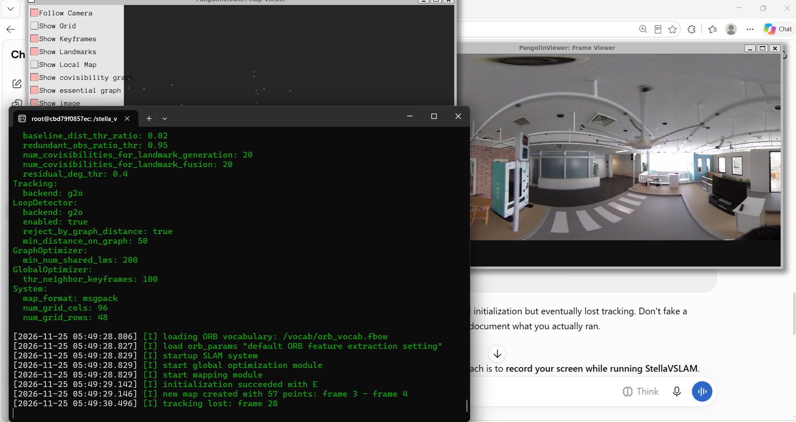
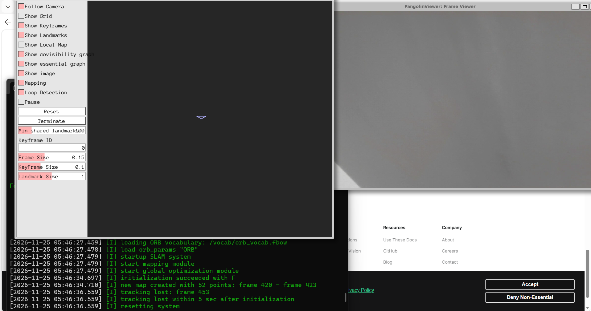

# Task 2 — VSLAM on Your Own Indoor Space

## 1. Reference Dataset

Screenshot showing StellaVSLAM running on the reference dataset:

## 2. Own Indoor Space

Screenshot showing StellaVSLAM running on my own indoor space:

## 3. YouTube Video

YouTube demonstration:

https://youtu.be/ciJZShMSUSc
